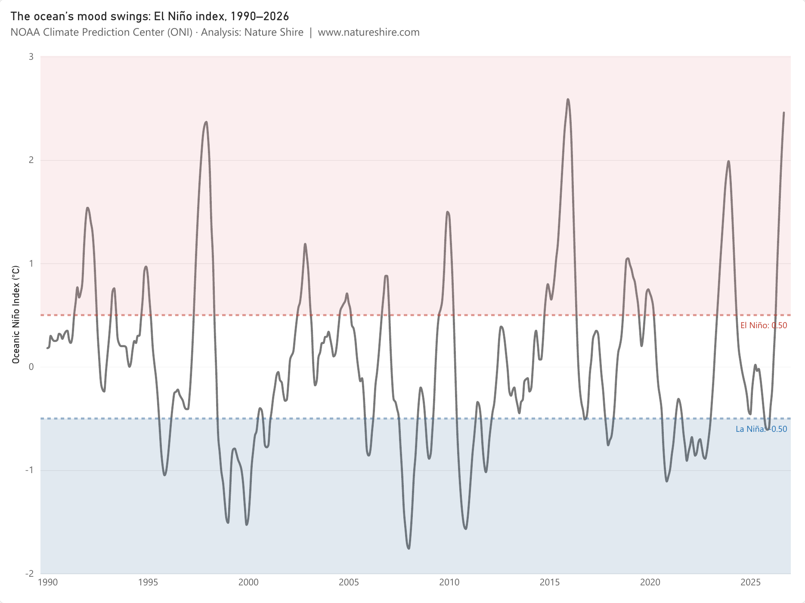
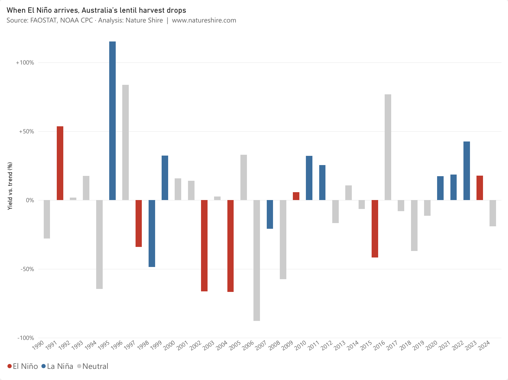
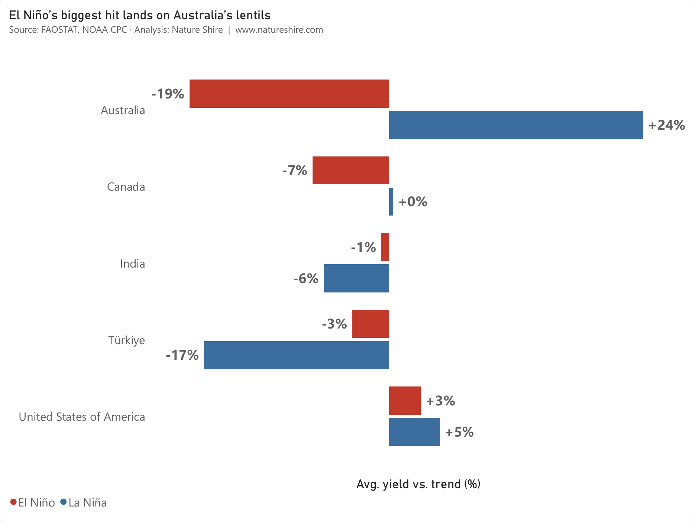
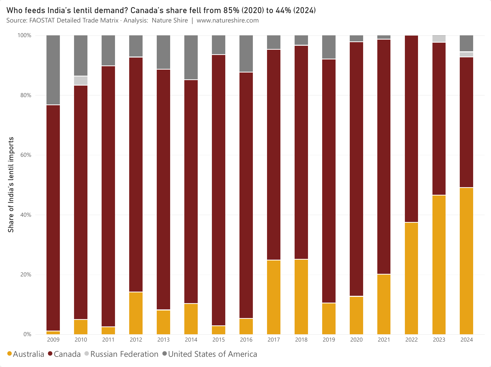

# Can the Pacific Ocean Sign a Trade Deal? El Niño, Lentils and India

**Nature Shire Market Intelligence · Data Detours #1 · November 2026 · Power BI (4 charts) + Python**

> El Niño cuts Australia's lentil harvest by about a fifth on average, but it does not decide who sells lentils to India. Trade policy does. In 2024 Australia overtook Canada as India's largest lentil supplier, just as the strongest growing-season El Niño on record hit Australia's 2026 crop and Canada and India race to close a trade deal.

## The question

Canada and India aim to conclude a trade agreement (CEPA) by December 2026, and pulse tariffs are one of the sticking points. At the same time, a very strong El Niño is under way. The question tested here:

**Does El Niño weaken Canada's competitors enough to shift India's lentil purchases toward Canada?**

Two links were tested separately:
1. Does El Niño reduce lentil yields in the major producing countries?
2. When Australia's harvest falls, does India buy more from Canada the following year?

## The story in four charts

| Chart | Finding |
|---|---|
|  | **The setting.** The 2026 El Niño reached +2.46 (Aug–Oct), the second-highest reading since 1950. Averaged over Australia's growing season (June–October so far) it is the strongest on record (+2.14, against +1.89 in 1997 and +1.87 in 2015). |
|  | **Link 1: Match for Australia.** In El Niño seasons Australia's lentil yields average 19% below trend; in La Niña seasons, 24% above. The deepest drops (1997, 2002, 2004, 2015) are all El Niño years. |
|  | **Only Australia shows a strong, reliable El Niño effect.** Canada (−7%), India, Türkiye and the USA show small or inconsistent swings. |
|  | **Link 2: Myth.** Australian shortfalls do not reliably push India toward Canada. Policy moves the market: after India's 30% lentil tariff (Dec 2017), Canadian sales fell from 791,000 t to 142,000 t. After Australia's 2022 trade deal, its share rose to 49% and overtook Canada in 2024. |

**Verdict: "It's complicated."** Weather decides how many lentils Australia grows; trade policy decides who sells them to India. For Canadian exporters, market access matters more than a competitor's bad season.

## Key numbers

| Test | Result | Reading |
|---|---|---|
| Australia: growing-season ONI vs yield anomaly | r = −0.40, p = 0.016, n = 35 (since 2000: r = −0.48, p = 0.015) | Significant |
| Canada: growing-season ONI vs yield anomaly | r = −0.12, p = 0.50 | Not significant |
| India, USA | r = 0.12 and 0.00 | Not significant |
| Australia's yield anomaly (year t) vs Canada's share of India's imports (t+1) | r = −0.26, p = 0.21, n = 25 | Weak, not significant |

## Stakeholders

- **A Canadian pulse exporter:** whether to bank on Australian weather or on market access
- **A trade policy analyst:** how tariffs and quotas compare with weather as drivers of market share
- **An Indian importer:** supplier risk when one origin is weather-exposed

## Method (Google Data Analytics six phases)

**Ask** → **Prepare** (NOAA ONI, FAOSTAT production and detailed trade matrix) → **Process** (Python: tidy tables, trend-adjusted yields, growing-season El Niño averages) → **Analyze** (correlation and phase comparison) → **Share** (Power BI, 4 charts) → **Act** (exporter takeaway: market access over weather)

- **Yield anomaly:** % deviation of each year's yield from that country's linear 1990–2024 yield trend, so long-term productivity gains don't masquerade as weather effects
- **Growing-season El Niño:** ONI averaged over each crop's own season: Australia Jun–Nov; Canada and USA May–Aug; Türkiye Nov–May; India the previous monsoon (Jun–Oct) for its winter (rabi) harvest
- **Phase:** season average ≥ +0.5 = El Niño, ≤ −0.5 = La Niña, otherwise neutral
- **Import shares** are calculated among the four suppliers downloaded (Canada, Australia, USA, Russia); the supplier chart starts in 2009 because earlier volumes were too small for shares to be meaningful

## Skills shown

- **Joining unrelated datasets** (ocean temperatures, crop yields, bilateral trade) on a common time key with crop-specific seasonal alignment
- **Detrending** before testing, and checking the result's robustness on a shorter window (2000–2024)
- **Hypothesis testing** with a willingness to report a null result ("Myth")
- **Power BI storytelling:** shaded threshold zones, phase-coloured columns, custom % formats, a consistent El Niño / La Niña palette across all charts, sources credited on every chart
- **Fact-checking policy context** against primary sources before publishing

## Repository contents

```
elnino-lentils-india/
├── charts/          4 chart images (Power BI)
├── data/
│   ├── raw/         original downloads (NOAA, FAOSTAT)
│   ├── oni_monthly.csv
│   ├── lentil_production_enso.csv
│   └── india_lentil_imports_clean.csv
└── scripts/prep.py  cleaning, joining and statistical tests
```

Run `python scripts/prep.py` (needs pandas, numpy, scipy) to rebuild the clean tables from the raw files and print the test results.

## Data and caveats

- **NOAA Climate Prediction Center**, [Oceanic Niño Index (ONI)](https://www.cpc.ncep.noaa.gov/data/indices/oni.ascii.txt), 1950 to Aug–Oct 2026
- **FAOSTAT** (FAO), Crops and livestock products: Lentils, dry; Canada, Australia, India, Türkiye, USA; 1990–2024 (CC BY 4.0)
- **FAOSTAT** (FAO), Detailed trade matrix: India's imports of Lentils, dry, by partner, 2000–2024 (CC BY 4.0)
- **Policy context:** USDA FAS GAIN report on India's 30% lentil tariff (Dec 21, 2017); Australian Department of Agriculture, AI-ECTA lentils tariff-rate quota (150,000 t/yr at half the MFN rate); Reuters (Oct 1, 2026) on India weighing pulse tariff cuts after a weak monsoon
- Correlation is not causation; the El Niño samples are small (5–9 seasons per phase per country). Australia's 1990s lentil area was very small, so early anomalies are noisy, but the result holds when restricted to 2000–2024.
- FAOSTAT trade data are reported by India (importer) by calendar year; Australia's harvest (Nov–Dec) mostly ships the following year, hence the one-year lag in Link 2.
- 2026 harvest and trade figures are not yet available; the 2026 El Niño finding is a signal to watch, not a forecast.

---

*Nature Shire Market Intelligence · natureshire.com*
