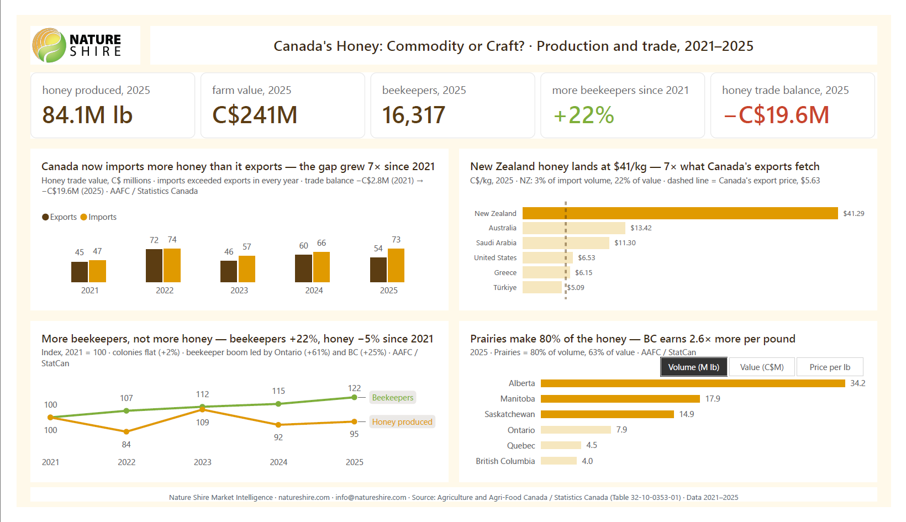

# Canada's Honey: Commodity or Craft?

**Nature Shire Market Intelligence · November 2026 · Power BI (1 page) + Excel**

> Canada sells its honey as a commodity at about C$5.63/kg, while New Zealand's lands in Canada at C$41/kg. This one-page report shows where the value in honey really sits: in provenance and branding, not volume.

## The story in four charts

| Chart | Finding |
|---|---|
| **Trade** | Canada imported more honey than it exported in every year 2021–2025; the trade deficit grew 7×, from −C$2.8M to −C$19.6M |
| **Price** ★ | New Zealand supplies 3% of Canada's honey imports by volume but 22% of their value: C$41.29/kg against Canada's average export price of C$5.63/kg |
| **Supply** | Beekeepers are up 22% since 2021 (Ontario +61%, BC +25%), but honey output is down 5% and colonies are flat |
| **Provinces** | The Prairies produce 80% of the honey but earn 63% of the value; BC earns C$5.96/lb against Alberta's C$2.25/lb (2.6×) |

**Takeaway:** about 1 in 4 pounds of Canadian honey is exported, mostly in bulk, while more than a quarter of the honey Canadians eat is imported. The opportunity for Canadian producers is branding, provenance and direct-to-consumer channels, not more volume.

## Stakeholders

- **A Prairie beekeeping co-op:** sells in bulk drums and wants better margins
- **A Canadian specialty food brand:** wants premium positioning at home and abroad
- **A food-trade buyer:** sourcing decisions on price against provenance

## Method (Google Data Analytics six phases)

**Ask** → **Prepare** (Agriculture and Agri-Food Canada / Statistics Canada, 2021–2025) → **Process** (two tidy Excel Tables) → **Analyze** (DAX) → **Share** (one-page report) → **Act** (premium-positioning recommendation)

## Skills shown

- **Field parameters:** one chart toggles between volume, value and price per lb, and the provincial ranking flips
- **DAX:** price per kg derived from value ÷ volume, index measures (2021 = 100), colour-returning measures for conditional formatting
- **Measure-driven reference line** (Canada's export price) and a **Top N** visual filter
- **Every KPI validated in DAX query view** (`EVALUATE`, `SUMMARIZECOLUMNS`) before visualisation
- **Measures deployed with a Tabular Editor C# script;** custom "Honeycomb" JSON theme

## Data and caveats

- Source: [AAFC, Statistical Overview of the Canadian Honey and Bee Industry 2025](https://agriculture.canada.ca/en/sector/horticulture/reports/statistical-overview-canadian-honey-and-bee-industry-2025) (Statistics Canada Table 32-10-0353-01 and trade data)
- Production value excludes inventory sales (except Quebec)
- Import and export prices are average unit values (value ÷ volume), not retail prices
- The honey-flow estimate (production − exports + imports) ignores inventory changes

---

*Nature Shire Market Intelligence · natureshire.com*
