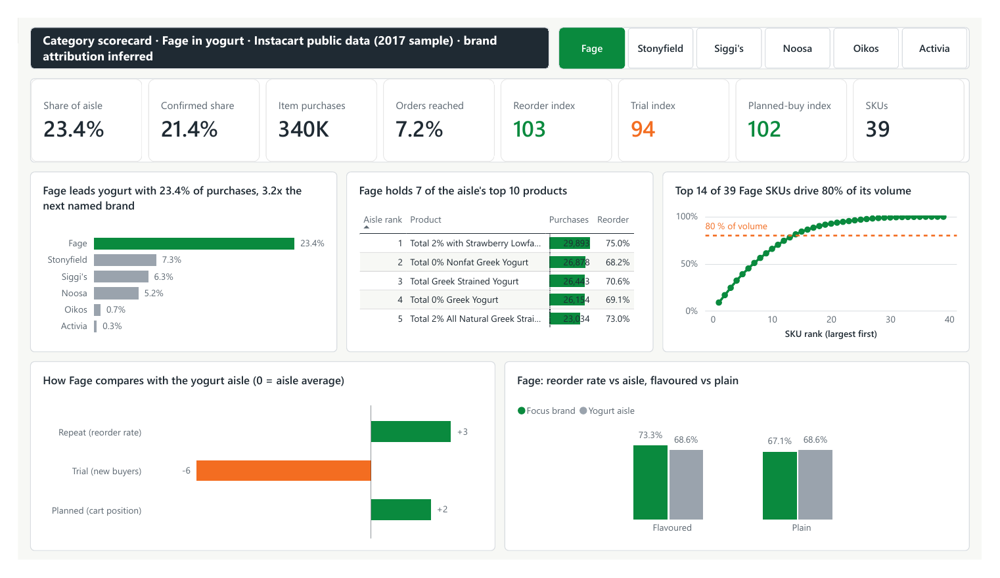
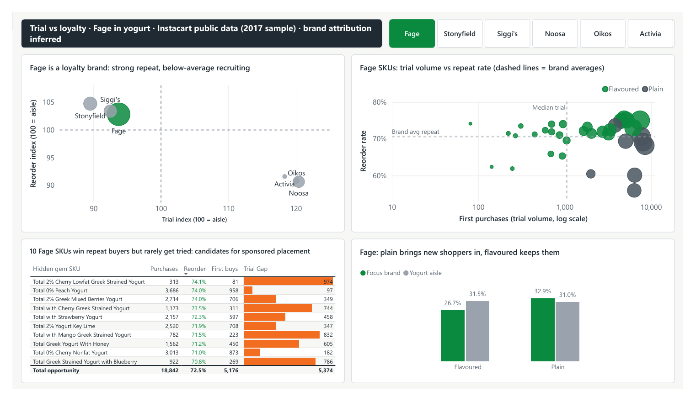
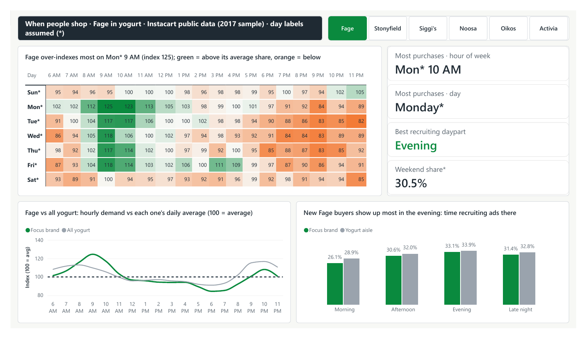
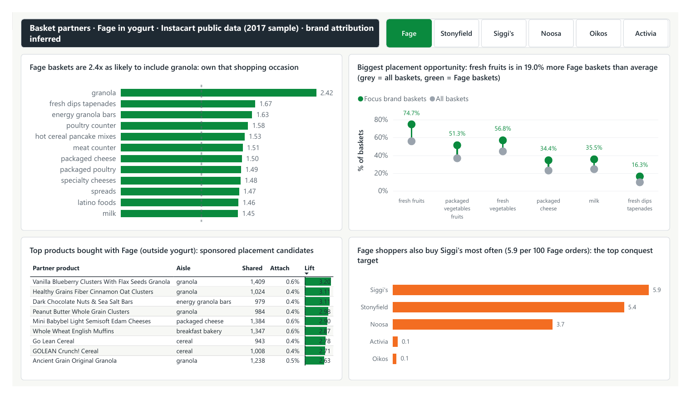
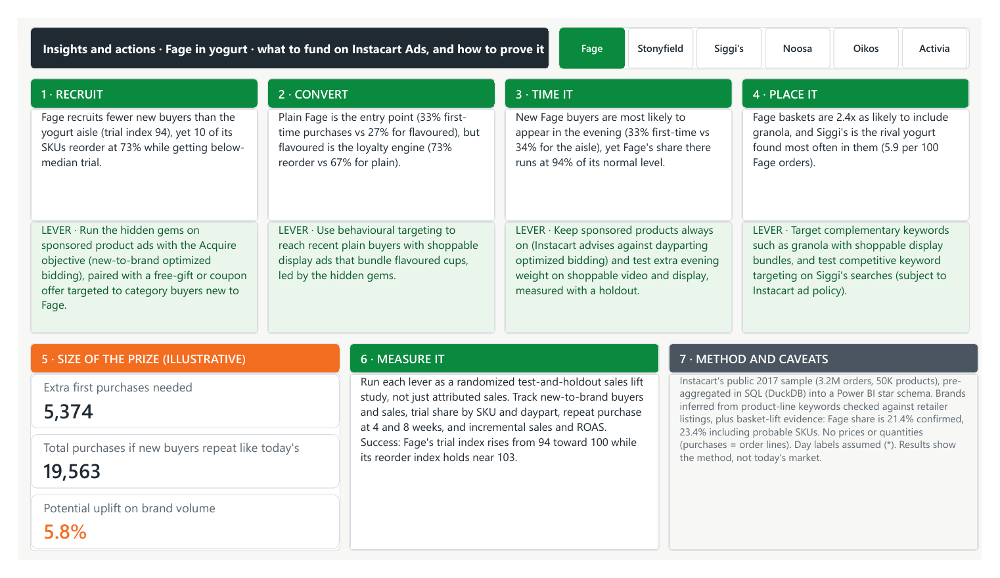

# Instacart Brand Scorecard: Yogurt Category

**A brand-partner category scorecard built the way a retail media insights team would present it to a CPG brand: where the brand stands, why, and what to fund on Instacart Ads, with a plan to prove the money worked.**

Power BI · DAX · DuckDB SQL · Power Query (M) · Tabular Editor (C#) · DAX query view

| | |
|---|---|
| **Core problem solved** | A CPG brand spends on retail media without knowing whether its gap is *recruiting* new buyers or *keeping* them, so budget goes to the wrong lever. |
| **Decision it enables** | Which SKUs, dayparts, basket occasions and competitor searches to fund, with a test-and-holdout plan to measure incremental sales. |
| **Focus brand** | Fage (the report works for any of the 6 named yogurt brands through one tile slicer) |

📄 **Full report:** [Fage PDF](pdf/Instacart_Brand_Scorecard_Fage.pdf) · [Noosa PDF](pdf/Instacart_Brand_Scorecard_Noosa.pdf)



---

## The story in one minute

1. **Hook:** Fage leads yogurt with **23.4%** of purchases, **3.2x** the next named brand, and holds **7 of the aisle's top 10** products.
2. **Rising action:** But Fage's trial index is **94**, so it recruits fewer new buyers than the aisle, while its reorder index is **103**. It's a loyalty brand that under-recruits.
3. **Climax:** **10 Fage SKUs** reorder at **72.5%** yet sit below the brand's median trial. They are hidden gems that convert whoever tries them, but few people get to try them.
4. **Falling action:** Plain Fage is the entry point (**32.9%** first-time purchases vs 26.7% for flavoured), while flavoured is the loyalty engine (**73.3%** reorder vs 67.1%). New Fage buyers show up most in the **evening**, when Fage's share runs at **94%** of its normal level. Fage baskets are **2.4x** as likely to include granola, and **Siggi's** is the rival yogurt found most often in them.
5. **Resolution:** Closing the gems' trial gap (**5,374** extra first purchases) is worth about **19,563** purchases at today's repeat rates, a **5.8%** lift on brand volume (illustrative).
6. **Denouement:** Every lever is run as a randomized test-and-holdout sales lift study. Success means Fage's trial index rises from 94 toward 100 while its reorder index holds near 103.

**Same report, opposite story:** select **Noosa** and the report flips. Noosa is a *trial* brand (trial index 120, reorder index 91), so the recommendation becomes RETAIN, and success means its reorder index rising toward 100.

---

## The five pages

| Page | Question it answers | Key visuals |
|---|---|---|
| 1 · Scorecard | Where does the brand stand in the aisle? | KPI row, share ranking, top-SKU table, 80/20 concentration curve, index vs aisle |
| 2 · Trial vs Loyalty | Is the gap recruiting or retention, and which SKUs? | Brand archetype scatter, SKU quadrant (log scale), hidden-gem table, plain vs flavoured |
| 3 · When People Shop | When do new buyers appear, and when does the brand over-index? | Day × hour share-index heatmap, demand index lines, recruiting by daypart |
| 4 · Basket Partners | What sits in the same basket, and who is the rival? | Aisle lift bars, excess-reach dumbbell, partner products, competitor co-purchases |
| 5 · Insights & Actions | What to fund on Instacart Ads, and how to prove it | 4 lever cards (Recruit, Convert, Time it, Place it), size of the prize, measurement plan, caveats |

| | |
|---|---|
|  |  |
|  |  |

---

## Recommended actions (Fage)

| Lever | Finding | Instacart Ads action |
|---|---|---|
| **1 · Recruit** | Trial index 94; 10 SKUs reorder at 73% with below-median trial | Sponsored product ads on the hidden gems with the Acquire objective (new-to-brand optimized bidding), plus a free-gift or coupon offer for category buyers new to Fage |
| **2 · Convert** | Plain recruits, flavoured retains | Behavioural targeting of recent plain buyers with shoppable display bundling flavoured cups |
| **3 · Time it** | New buyers peak in the evening; Fage's share there runs at 94% | Keep sponsored products always on (Instacart advises against dayparting optimized bidding); test extra evening weight on shoppable video and display |
| **4 · Place it** | Granola lift 2.4x; Siggi's is the top co-purchased rival | Complementary keyword targeting (granola) with shoppable display; test competitive keyword targeting on Siggi's searches, subject to ad policy |

---

## Process (Google Data Analytics: Ask, Prepare, Process, Analyze, Share, Act)

- **Ask:** Two stakeholders. *Elena Marsh*, Director of eCommerce & Retail Media at the brand, needs to know where to put next quarter's budget. *Priya Raman*, the Instacart Ads partner lead for dairy, needs a data-backed pitch that grows the brand's spend and proves incrementality.
- **Prepare:** Instacart's public 2017 sample: 3.4M orders in total (3.2M with prior baskets), 33.8M order lines, 49,688 products.
- **Process:** DuckDB SQL pre-aggregates 33.8M order lines into small fact tables (product, product × day × hour, basket pairs). Brands are inferred from product-line keywords checked against retailer listings, plus basket-lift evidence for unbranded SKUs (each tagged High or Medium confidence).
- **Analyze:** About 125 DAX measures across a star schema: share, reorder and trial indexes, cart-position index, RANKX ranks, TOPN cumulative share, MEDIANX thresholds, lift and excess reach, and SWITCH-driven narrative text.
- **Share:** Five pages with action titles that rewrite themselves for whichever brand is selected.
- **Act:** Four funded levers, a size-of-prize estimate and a test-and-holdout measurement plan.

---

## Technical highlights

- **Brand-agnostic by design:** one disconnected `Dim_Brand` tile slicer synced across all pages; every measure, title and recommendation is computed for the selected brand. Tiles are ordered by market share, calculated in Power Query.
- **Self-writing insights:** Page 5 cards choose their own headline (RECRUIT vs RETAIN), finding and lever text from the data, with fallbacks for edge cases (no hidden gems, no plain/flavoured split, possessives such as *Siggi's* and *Oikos'*). Tested on all 6 brands.
- **SQL pre-aggregation:** 33.8M raw rows reduced to compact facts in DuckDB, so the model stays small and fast.
- **Power Query:** parameterised folder path, a reusable `fnLoadCsv` function, and date and hour dimensions built in M.
- **Tabular Editor C# scripts:** bulk measure creation, display folders by page, and model hygiene (hidden keys, sort-by columns, no default summarisation).
- **DAX query view:** measures tested across all brands in one query, then written back with *Update model with changes*.
- **Custom visuals from standard ones:** a dumbbell chart built from a line chart with error bars; a share-index heatmap from a matrix with diverging conditional formatting.
- **Design:** custom JSON theme (one action colour, one alert colour, grey for context); no pie charts, treemaps or dual axes.

---

## Why it matters now

Retail media is now a core budget line for CPG brands. Instacart's own tools reflect this: its Consumer Insights Portal and Data Hub clean room surface new-to-brand and repurchase metrics to brand partners, and its ads platform offers new-to-brand bidding, shoppable display and video, and randomized lift studies. This project shows the analysis behind those numbers: turning shopper data into a recommendation a brand can fund and measure.

---

## Limitations

- **The data is from 2017.** Results show the method, not today's market.
- **Brands are inferred.** Product names rarely include the brand. Fage's share is 21.4% on confirmed SKUs and 23.4% including probable SKUs (basket-lift evidence).
- **No prices or quantities.** A "purchase" is an order line, so these are unit-share proxies, not sales value.
- **Day labels are assumed** (marked \*). The dataset gives day numbers 0–6 without names.
- The "size of the prize" is illustrative: it assumes new buyers repeat like today's buyers.

---

## Repository contents

```
instacart-brand-scorecard/
├── README.md
├── pdf/      Fage and Noosa report PDFs
├── images/   page screenshots
└── sql/      00_load.sql … 07_export.sql (DuckDB)
```

The `.pbix` and data files are not included.

## Data and licence

Data: *The Instacart Online Grocery Shopping Dataset 2017*, released by Instacart for non-commercial use. In line with its terms, **no raw or derived data is redistributed here**. To reproduce the analysis, download the dataset from its official source and run the SQL scripts in order. This is an independent portfolio project, not affiliated with or endorsed by Instacart or any brand shown.

---

**Fraz** · Data Analyst & BI Developer, Metro Vancouver · [GitHub](https://github.com/frazbama) · frazbama@gmail.com
